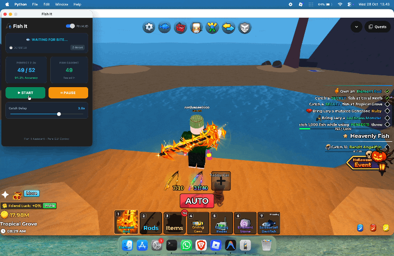
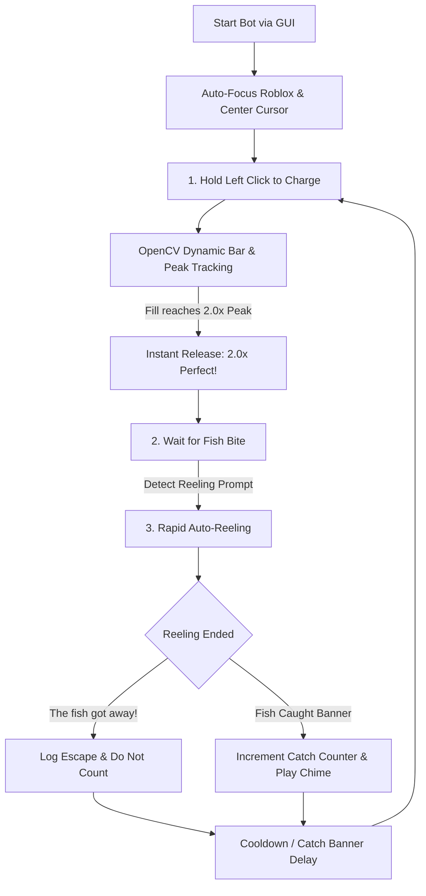

<div align="center">

# 🎣 roblox-fishit-autoperfect

[](https://www.python.org/)
[](https://github.com/ricostwn/roblox-fishit-autoperfect)
[](https://opencv.org/)
[](https://github.com/TomSchimansky/CustomTkinter)
[](LICENSE)

An intelligent, cross-platform autonomous fishing assistant designed for Roblox *Fish It!*.  
Combines **dynamic OpenCV template matching**, **sub-millisecond frame processing**, and a sleek **dark-mode floating HUD** for **Windows & macOS**.

[Features](#-key-features) • [How It Works](#-how-it-works) • [Installation](#-installation) • [Quick Start](#-quick-start) • [Permissions](#-macos-permissions) • [License](#-license)

<br/>



</div>

---

## ✨ Key Features

- **🎯 Dynamic 2.0x Perfect Casts:** Uses real-time OpenCV template tracking to locate the 3D charge bar across any camera angle, rotation, or zoom, releasing at the exact millisecond the 2.0x Luck peak is reached.
- **🌙 Day & Night Lighting Invariant:** Uses integer-safe channel dominance ratios rather than fragile static brightness thresholds, ensuring flawless detection in bright midday sun or pitch-black midnight cave lighting.
- **🌀 Smart Auto-Reeling:** Automatically detects the in-game reeling minigame via OpenCV template matching and rapid-clicks at low latency to reel the catch in, handling any fish rarity or duration.
- **🛡️ Escape vs. Catch Verification:** Distinguishes between successful catches and fish escapes (`The fish got away!`), guaranteeing 100% accurate session metrics.
- **🚀 Native Window Auto-Focus (Cross-Platform):** Automatically brings Roblox to the foreground and centers the mouse cursor upon clicking **START** (powered by Windows `user32` on Windows and Cocoa `NSWorkspace` on macOS).
- **🖥️ Dark-Mode Floating HUD:** Minimalist CustomTkinter overlay with live session statistics (Perfect Throws ratio, dynamic Accuracy %, fish catches, and session stopwatch).

---

## 🔄 How It Works



---

## 📁 Project Structure

```text
roblox-fishit-autoperfect/
├── app.py               # Modern CustomTkinter GUI application (Windows & macOS)
├── main.py              # Lightweight headless / terminal engine
├── Launch.bat           # One-click launcher for Windows
├── Launch.command       # One-click launcher for macOS
├── config.json          # Persistent configuration settings & thresholds
├── requirements.txt     # Python project dependencies (PEP 508 cross-platform)
├── templates/           # OpenCV reference templates for dynamic tracking
│   ├── charge_label.png # Bar anchor template
│   └── stop_button.png  # Reeling detection template
├── calibrate.py         # Interactive coordinate & color inspection tool
├── test_timing.py       # Fine-grained millisecond hold-time tester
├── LICENSE              # MIT License
└── README.md            # Project documentation
```

---

## 💻 Installation

### 1. Clone the Repository
```bash
git clone https://github.com/ricostwn/roblox-fishit-autoperfect.git
cd roblox-fishit-autoperfect
```

### 2. Set Up Virtual Environment & Dependencies

#### On Windows:
```cmd
python -m venv .venv
.venv\Scripts\activate
pip install -r requirements.txt
```

#### On macOS:
```bash
python3 -m venv .venv
source .venv/bin/activate
pip install -r requirements.txt
```

---

## 🚀 Quick Start

### Option 1: One-Click Desktop Launcher (Recommended)
- **Windows:** Double-click **`Launch.bat`**
- **macOS:** Double-click **`Launch.command`**

### Option 2: Command Line
```bash
python app.py
```

### In-App Controls:
- Click **`▶ START`**: Automatically activates Roblox, positions your cursor, and begins the infinite fishing loop.
- Click **`⏸ PAUSE`**: Pauses the loop instantly.
- Click **`↺ Reset`**: Clears session statistics and resets the timer.
- Toggle **`Pin HUD`**: Keeps the assistant floating above the Roblox window.

---

## ⚙️ Configuration (`config.json`)

| Parameter | Default | Description |
|---|---|---|
| `target_x`, `target_y` | `845`, `416` | Reference baseline coordinates for the charge bar fill |
| `stop_button_x`, `stop_button_y` | `1095`, `816` | Reference location for the in-game reeling `[STOP]` button |
| `cast_settle_delay` | `1.5` | Delay in seconds for the bobber to land in the water |
| `post_catch_delay` | `2.2` | Time to wait after catching a fish before starting the next cast |
| `click_speed` | `0.025` | Interval between rapid clicks during the reeling phase |
| `always_on_top` | `true` | Keeps the HUD card floating on top of all windows |

---

## ⚠️ macOS Permissions

Because this tool captures screen pixels and simulates mouse inputs, macOS requires security permissions for your terminal or runner app (Terminal, iTerm2, or VS Code):

1. **Screen Recording:**  
   `System Settings` $\rightarrow$ `Privacy & Security` $\rightarrow$ `Screen Recording` $\rightarrow$ Toggle **ON** your terminal app.
2. **Accessibility:**  
   `System Settings` $\rightarrow$ `Privacy & Security` $\rightarrow$ `Accessibility` $\rightarrow$ Toggle **ON** your terminal app.

---

## ⚖️ Disclaimer

This software is developed strictly for educational and automation demonstration purposes. Automating gameplay may violate the Terms of Service of specific platforms or experiences. Use responsibly and at your own discretion.

---

## 📄 License

This project is licensed under the [MIT License](LICENSE).

## ⚖️ Disclaimer

This software is developed strictly for educational and automation demonstration purposes. Automating gameplay may violate the Terms of Service of specific platforms or experiences. Use responsibly and at your own discretion.

---

## 📄 License

This project is licensed under the [MIT License](LICENSE).

